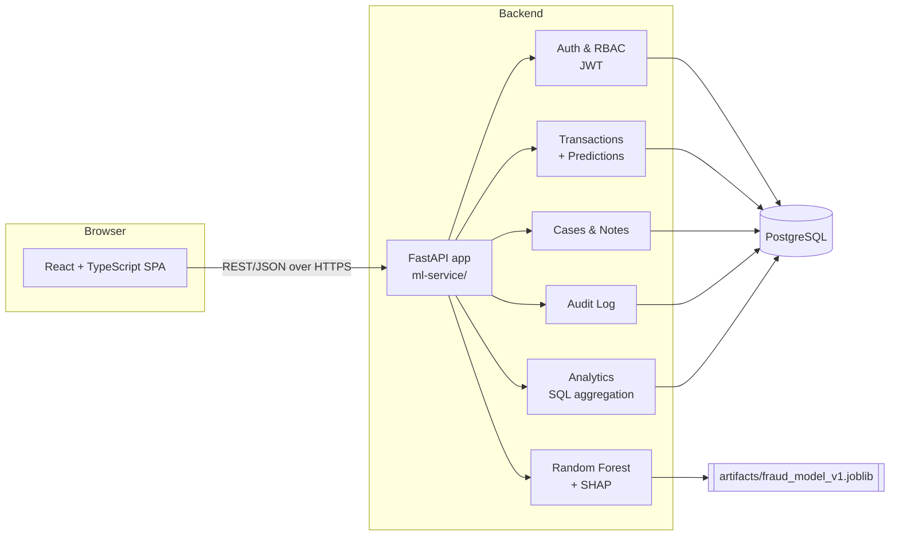
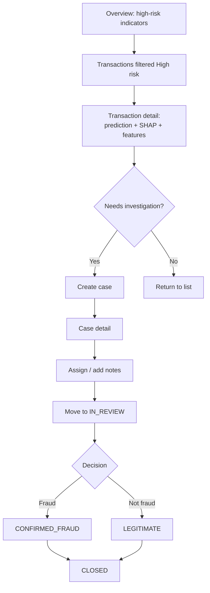
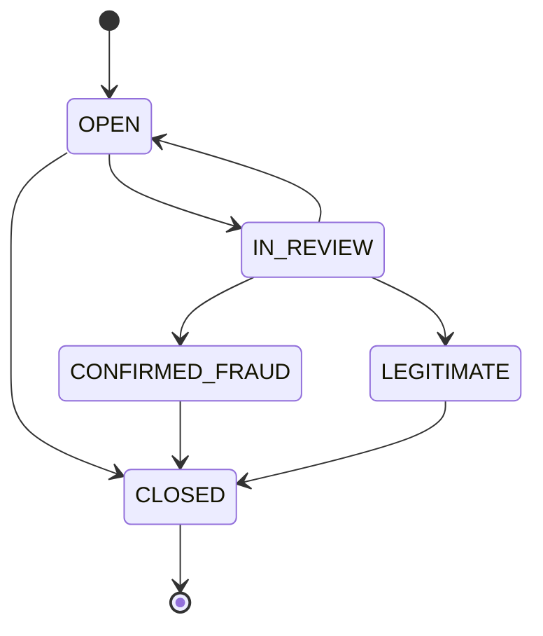
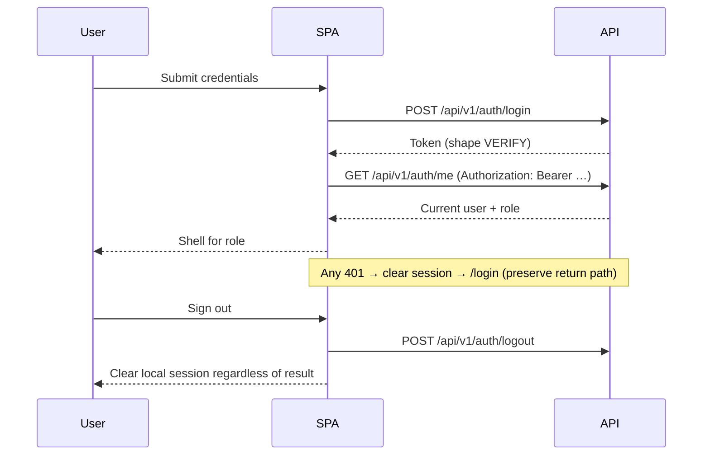

# FraudShield AI — Frontend Design Specification

**Audience:** Antigravity (implementation agent)
**Status:** Design specification. No application code is part of this document.
**Scope:** React + TypeScript frontend integrating with the existing FastAPI backend in `ml-service/`.

---

## 0. Verification Legend (read first)

This document was written from the project brief only. The repository, OpenAPI schema, and PRD were **not** available to the author. Every fact is therefore tagged:

| Tag | Meaning |
|---|---|
| **[REPORTED]** | Stated in the project brief / Phase 1–4 audit report. Believed correct, not confirmed against source. |
| **[VERIFY]** | Must be confirmed against source code or `/openapi.json` before it is built on. |
| **[DESIGN]** | A decision made by this spec; not a backend fact. |
| **[UNKNOWN]** | The brief does not say. Do not guess. Discover, then record in §27. |

**Rule:** If a field name, parameter, or response shape is not tagged as verified in your working notes, do not write code against it. Generate TypeScript types from the OpenAPI schema where possible; hand-write types only for confirmed shapes.

---

## 1. Document Purpose and Implementation Rules

### 1.1 Purpose
Defines the visual language, information architecture, page behavior, component system, integration architecture, and acceptance criteria for the FraudShield AI frontend.

### 1.2 Non-negotiable rules
1. **Real data only.** Every production screen reads from the live backend. No mock service in the production path. Design-time mocks live in a separate, clearly named directory and are never imported by production code.
2. **No invented contracts.** No endpoints, query params, request fields, response fields, status codes, or enum values beyond those verified.
3. **Backend is the security boundary.** Frontend role-awareness is a usability layer only.
4. **Three distinct concepts, always visually separate:**
   - **Transaction** — the stored record and its feature vector.
   - **Prediction** — the model's output (probability, risk tier, optional SHAP). A machine estimate.
   - **Investigation outcome** — a human decision recorded on a case.
5. **Never say "fraud" about a prediction without qualification.** Use "predicted fraud", "high model risk", or "flagged by model". "Confirmed fraud" is reserved for the `CONFIRMED_FRAUD` case status.
6. **No fabricated entities.** No customer names, card numbers, merchants, geography, or devices. The dataset has none.
7. **Failure is not zero.** Never render a failed request as an empty chart or `0`.
8. **Do not implement anything the backend does not support.**

### 1.3 Process
Before any code: complete the discovery checklist in §17.1, produce the verified contract matrix (§18), and record deviations in §27.

---

## 2. Product Overview and User Goals

FraudShield AI is a financial transaction fraud detection and risk monitoring platform: ML scoring, persistent records, case-based investigation, RBAC, audit logging, and analytics.

### 2.1 What the UI must make easy
| # | Goal | Primary surface |
|---|---|---|
| 1 | See current risk posture and trends | Overview, Analytics |
| 2 | Inspect a transaction and its prediction | Transactions, Transaction Detail |
| 3 | Score a supported input | Score Transaction |
| 4 | Investigate suspicious transactions via cases | Investigations |
| 5 | Assign cases to eligible analysts | Case detail |
| 6 | Record append-only notes | Case detail timeline |
| 7 | Review audit events (where permitted) | Audit Logs |
| 8 | Monitor aggregate analytics | Overview, Analytics |
| 9 | Understand prediction vs. human outcome | Everywhere (copy + visual separation) |

### 2.2 Product tone
Accountable, precise, calm. The UI conveys that every consequential action is attributable and recorded.

---

## 3. Existing Architecture and Technical Constraints



### 3.1 Backend facts
| Item | Value | Tag |
|---|---|---|
| Language/framework | Python, FastAPI, Pydantic v2 | REPORTED |
| ORM / DB | SQLAlchemy 2.x, PostgreSQL, psycopg 3, Alembic | REPORTED |
| Auth | JWT via `python-jose`, bcrypt hashing | REPORTED |
| Model | Random Forest, Kaggle credit-card fraud data (284,807 rows, 492 fraud, ≈0.1727%) | REPORTED |
| Model artifact | `artifacts/fraud_model_v1.joblib` | REPORTED |
| Model inputs | `Time`, `Amount`, `V1`–`V28` (V = anonymized PCA) | REPORTED |
| Explanations | SHAP, stored with predictions where supported | REPORTED |
| Tooling versions | Python 3.11.9, PostgreSQL 17, SQLAlchemy 2.0.40, Alembic 1.15.2, Pytest 9.1.1, Ruff 0.11.0 | REPORTED — confirm in repo |
| Frontend exists? | Unknown | UNKNOWN |
| CORS config | Unknown | VERIFY |

### 3.2 Constraints
- No second backend. No direct DB access from the frontend. No ML logic duplicated in the browser.
- Frontend config is environment-driven (§17).
- Backend regression tests must remain green throughout.

---

## 4. Personas and Role Permissions

Roles are enforced server-side. Frontend mirrors them for UX only.

| Capability | ADMIN | ANALYST | AUDITOR | Tag |
|---|---|---|---|---|
| Login / view own profile | ✔ | ✔ | ✔ | REPORTED |
| View analytics | ✔ | ✔ | ✔ | REPORTED |
| View transactions | ✔ | ✔ | ✔ | VERIFY |
| Score a transaction | VERIFY | VERIFY | VERIFY (likely denied — read-only) | VERIFY |
| View cases | All | Assigned + unassigned queue | All (read-only) | REPORTED |
| Create case | VERIFY | VERIFY | ✘ | VERIFY |
| Change case status | VERIFY | Permitted subset | ✘ | VERIFY |
| Assign case | VERIFY | Restricted (no free reassign of others' cases) | ✘ | REPORTED/VERIFY |
| Add note | VERIFY | When permitted & case not CLOSED | ✘ | VERIFY |
| View audit logs | ✔ (intended) | VERIFY | ✔ (intended) | VERIFY |
| User management | ✔ only | ✘ | ✘ | REPORTED |

### 4.1 Persona intent
- **Analyst — "Priya, working a queue."** Wants density, fast filtering, keyboard flow, minimal clicks to log a note.
- **Auditor — "reviewing without touching."** Wants read-only clarity; mutation controls absent (not merely disabled) with a short explanation where an absence would confuse.
- **Admin — "operating the system."** Wants visibility across everything plus user administration.

### 4.2 Role-aware UI rules
1. Hide navigation items the role can never use (e.g., User Management for non-admins).
2. For actions that are conditionally available (e.g., note on a closed case), **show the control disabled with a reason** rather than hiding it, so the rule is learnable.
3. For actions the role can never perform (Auditor mutations), **omit** the control and show a persistent "Read-only access" indicator in the page header.
4. Always handle `403` from the server even if the UI predicted success.
5. Never read the role from a client-editable source as authorization; take it from `GET /auth/me`.

---

## 5. Information Architecture and Navigation

| Order | Label | Route (proposed) [DESIGN] | Roles |
|---|---|---|---|
| 1 | Overview | `/overview` | All |
| 2 | Transactions | `/transactions`, `/transactions/:id` | All (VERIFY) |
| 3 | Score Transaction | `/score` | Per backend (VERIFY) |
| 4 | Investigations | `/investigations`, `/investigations/:caseId` | All |
| 5 | Analytics | `/analytics` | All |
| 6 | Audit Logs | `/audit-logs` | Admin, Auditor (VERIFY analyst) |
| 7 | User Management | `/admin/users` | Admin |
| — | Account menu | popover | All |
| — | Login | `/login` | Public |

Default authenticated route: `/overview`. Unknown routes → in-shell "Not found" page. Forbidden routes → in-shell "Access restricted" page (not a silent redirect, so users understand why).

### 5.1 Shell layout
```
┌────────┬──────────────────────────────────────────────┐
│        │ Top bar: breadcrumb · page-level context · ⌄ │
│ Side-  ├──────────────────────────────────────────────┤
│ bar    │ Page header: title, description, actions     │
│ 232px  │ Filter bar (sticky where useful)             │
│        │ Content                                      │
└────────┴──────────────────────────────────────────────┘
```
- Sidebar: wordmark, nav groups ("Monitor": Overview, Analytics; "Work": Transactions, Score, Investigations; "Governance": Audit Logs, Users), account block at bottom with name, role badge, sign out.
- Collapsible to a 56px icon rail on desktop (preference persisted in `localStorage`, wrapped in try/catch).
- Top bar is slim (48px). It carries breadcrumbs on detail pages and a **data-freshness indicator** ("Updated 14:32 IST" + refresh) rather than decorative widgets.

---

## 6. User Journeys and Critical Workflows

### 6.1 Triage flow


### 6.2 Case state machine **[REPORTED — server is authoritative]**

The UI renders transition buttons from this map **as a convenience**. Treat any server rejection as authoritative and show its message. Do not add transitions. If the API exposes allowed transitions (VERIFY), prefer that over a hardcoded map.

### 6.3 Scoring flow
Enter inputs → submit → result (probability, risk tier, explanation if returned) → link to persisted transaction if an id is returned → optional "Open case" (if permitted).

### 6.4 Session lifecycle


---

## 7. Page-by-Page Specifications

Each page defines: purpose, layout, data, states, responsive, accessibility. Shared state patterns are in §19; this section lists page-specific additions.

### 7.1 Login (`/login`)
- **Layout:** Two-column on ≥1024px: left panel (product wordmark "FraudShield" in the display face, one-paragraph description, three short capability lines in text — no illustrations), right panel with form. Single column below 1024px; description collapses under the form.
- **Fields:** Email, Password (visibility toggle with `aria-pressed`). Field names per login schema (VERIFY — it may be OAuth2 form-encoded or JSON; do not assume).
- **Validation:** inline on blur and submit; email format; non-empty password. No password-strength rules on login.
- **States:** idle; submitting (button shows spinner + "Signing in…", fields disabled, `aria-busy`); invalid credentials (inline alert above form, `role="alert"`, generic message — do not reveal whether the email exists); deactivated user (show backend's message if distinct; VERIFY status code); network failure ("Can't reach the server. Check your connection and try again." + retry); session expired (arrived via redirect → neutral banner "Your session has ended. Sign in again.").
- **Forbidden:** social login, "forgot password" or "sign up" links unless the backend supports them (not reported).
- **Autofill:** correct `autocomplete="username"` / `current-password`.

### 7.2 Overview (`/overview`)
**Purpose:** Fast situational awareness; most actionable information first.

**Data (REPORTED endpoints; VERIFY shapes):** `analytics/overview`, `analytics/risk-distribution`, `analytics/trends`, `analytics/case-status-distribution`.

**Layout (desktop, top → bottom):**
1. Page header + **date-range control** (default range: [DESIGN] last 7 days, daily interval; confirm default against backend).
2. **Primary summary strip** — one dominant block, not four equal cards (see §13).
3. Row: Trend chart (≈8/12 columns) | Risk distribution (≈4/12).
4. Row: Case-status distribution | Investigation queue summary.
5. **Recent risk activity table** — only if an existing endpoint supports it (e.g., `GET /transactions` sorted by risk or time with a high-risk filter; VERIFY sort/filter params). If not supported, **omit the section** — do not fake it.

**Independence:** each widget loads and fails independently (§19.6).

**Definitions:** every metric has an info affordance (`ⓘ` popover) stating its exact backend definition (e.g., "Uses the latest prediction per transaction" [REPORTED]; "Trend counts raw prediction events by prediction time" [REPORTED]). Never show a rate without its denominator in plain text.

### 7.3 Transactions (`/transactions`)
- **Table columns [DESIGN, field names VERIFY]:** Transaction ID, Timestamp, Amount, Fraud probability, Risk tier, Predicted class, Case indicator (only if the list response includes it; otherwise omit).
- **Filters:** risk level, predicted class (VERIFY accepted param names/values). **Sorting:** only on fields the API supports (VERIFY).
- **Pagination:** server-backed using actual response contract (limit/offset vs. page vs. cursor — VERIFY). Show "Showing X–Y of N" only if a total is returned.
- **Filters in URL query string** so views are shareable/restorable.
- **Row action:** whole row navigates to detail; id is also a real link (keyboard/middle-click).
- **Loading:** skeleton rows matching column widths. **Empty:** "No transactions match these filters" + "Clear filters". **Distinct empty-for-system:** "No transactions have been recorded yet."
- **Mobile:** table becomes a stacked list (see §20).

### 7.4 Score Transaction (`/score`)
Backend: `POST /api/v1/transactions/score` [REPORTED]. VERIFY: required fields, `explain` flag, threshold-override field name and permission, response shape, role restrictions.

**Input design — avoid a 30-field wall:**
- **Section A — Core inputs (always visible):** `Time`, `Amount`. Units/semantics per dataset: `Time` = seconds elapsed since first transaction in the dataset [REPORTED dataset convention — VERIFY backend description]; `Amount` formatting with currency symbol **only if** backend specifies currency (UNKNOWN — default to plain numeric with no symbol).
- **Section B — Anonymized features V1–V28 (collapsed by default):** accordion with three sub-groups of 9–10 fields (V1–V10, V11–V19, V20–V28) — a purely organizational grouping with **no semantic meaning**. Persistent helper text: "V1–V28 are anonymized PCA components. They carry no interpretable real-world meaning."
- **Bulk entry (advanced):** a "Paste feature vector" mode accepting JSON keyed by feature name (and/or CSV row). Parse client-side, validate against the same schema, report which keys are missing/invalid. Include "Copy current inputs as JSON".
- **Options:** "Include explanation (SHAP)" toggle if the API supports `explain`. Threshold override only if the API permits it for the user's role; label it as an advanced option and show the default threshold from the backend if available.
- **Validation:** numeric only; accept negatives and decimals for V-features; reject NaN/Infinity/empty; show the first invalid field in an error summary with anchor links. Do not impose ranges not documented by the backend.
- **Submit:** "Score transaction". Loading state disables the form and preserves values. **On error, values are retained.** Validation errors from the server (422) map to field errors using the server's `loc` path (VERIFY format).
- **Result view** (replaces or sits beside the form):
  - **Predicted fraud probability** (large numeric, formatted %, with raw value in tooltip).
  - **Risk tier badge** and **decision threshold used** — displayed separately from probability and from the backend "risk score" (if that is a distinct field; VERIFY).
  - Explanation: see §14.4.
  - Link "View stored transaction" if an id is returned; "Open investigation" if permitted.
  - Persistent caveat: "This is a model estimate, not a determination of fraud."
- **Not allowed:** pre-filled "sample fraud" buttons that fabricate data presented as real. If a sample loader is offered for demo, label it "Example input (not a real transaction)" and keep it out of any production persistence path — **recommend omitting.**

### 7.5 Transaction Detail (`/transactions/:id`)
Backend: `GET /api/v1/transactions/{id}` [REPORTED].
- **Header:** ID, timestamp, amount, latest risk-tier badge, "Open case" / "View case" action (permission-gated).
- **Sections (vertical, anchor-linked):**
  1. **Latest prediction** — probability, tier, threshold, model version if returned, prediction time.
  2. **Explanation** — SHAP contributions if present; else "No explanation stored for this prediction."
  3. **Feature vector** — `Time`, `Amount`, `V1`–`V28` in a compact two-column monospaced list with copy button. Muted note that V-features are anonymized.
  4. **Linked case(s)** — only if returned/queryable (VERIFY).
  5. **Prediction history** — **render only if** the transaction-detail response includes it or a documented endpoint exists. Do not invent an endpoint. [UNKNOWN]
- 404 → "Transaction not found" panel with link back to list.

### 7.6 Investigations (`/investigations`, `/investigations/:caseId`)
**List (queue):**
- Columns [VERIFY fields]: Case ID, Status badge, Linked transaction, Risk tier of linked prediction (if returned), Assignee, Created, Updated.
- Filters: status (multi), assignee (including "Unassigned", "Assigned to me"), per supported params (VERIFY).
- Analysts see backend-scoped results; UI doesn't pretend to show all cases. Header copy for analysts: "Showing your cases and the unassigned queue." (confirm exact rule).
- "New case" action requires selecting a transaction (by ID). Duplicate creation → show server conflict message and link to the existing case if the error provides it (VERIFY).

**Detail — two-pane layout (desktop):**
- **Left (≈60%) — Activity timeline:** chronological, oldest→newest (or newest-first with toggle; default oldest→newest, composer at the bottom). Entries: notes (author, role, timestamp, body) and — only if the API supplies them — status/assignment events. Visual cue: a lock glyph + "Notes can't be edited or deleted" in the section header.
- **Right (≈40%) — Context rail:** status + valid transition actions; assignment control; linked transaction summary (amount, probability, tier, link); prediction context with the "model estimate" caveat; dates.
- **Status change:** buttons for each valid next state; each opens a confirmation dialog stating *from → to*, an irreversible warning for `CLOSED` ("Closed cases are terminal and cannot receive notes"), and for `CONFIRMED_FRAUD`/`LEGITIMATE` a reminder that this records a human determination. Include optional comment only if the PATCH schema supports one (VERIFY).
- **Assignment:** combobox listing eligible assignees — **active users with role ANALYST** [REPORTED]. VERIFY where the list comes from: `GET` users is admin-only [REPORTED], so analysts may not be able to list candidates. If no non-admin endpoint exists, expose assignment as "Assign to me"/"Unassign" for analysts and the full picker for admins only, and log this in §27.
- **Note composer:** multiline, character counter if the schema has a max (VERIFY), "Add note" (primary). Visible only if the user may add notes; disabled with reason on `CLOSED` ("This case is closed. Notes can no longer be added."). Auditor: omitted; show read-only indicator.
- **Conflicts:** if a PATCH returns an error indicating stale state/invalid transition (VERIFY codes, likely 400/409/422), show the server message in a dialog-level alert, refetch the case, and keep the user's pending text.
- **Important limitation [REPORTED]:** after a case moves to `CLOSED`, the schema has no separate lifetime outcome field. The UI therefore **must not** claim "this case was confirmed fraud" from a `CLOSED` status. In the timeline, show prior status transitions only if the API supplies history. In any aggregate, never derive lifetime fraud/legitimate counts from current status (§14.6).

### 7.7 Analytics (`/analytics`)
Purpose beyond Overview: **depth and definitions**.
- **Global filter bar:** date range, trend interval (hour/day), with constraint hints (hourly ≤ 30 days, daily ≤ 365 days [REPORTED] — VERIFY, and prevent invalid combinations in the UI while still handling server errors).
- **Sections (tabbed or anchored):**
  1. **Risk distribution** — tier counts + percentages of the evaluated set; table beneath the chart with exact numbers.
  2. **Evaluation trends** — time series of prediction events; toggle between count series the API actually returns (VERIFY series); data table view toggle for accessibility.
  3. **Case-status distribution** — current stored statuses; footnote about the limitation above.
  4. **Feature importance** — mean absolute SHAP ranking; controls: `risk_level` filter (LOW/MEDIUM/HIGH) and `limit` (VERIFY bounds); the disclaimer is mandatory (§14.4).
  5. **Definitions** panel (collapsible): each metric → source endpoint → plain-language definition → time semantics.
- **Static vs. operational:** if model-evaluation metrics (precision, recall, F1, PR-AUC, ROC-AUC) are displayed at all, place them in a separate "Model evaluation (static, from training/test)" block with "Not live operational metrics" label, and only if supplied by an API or documented source. Do not hardcode them into KPI cards. **Recommendation: omit unless an endpoint supplies them.**

### 7.8 Audit Logs (`/audit-logs`)
Backend: `GET /api/v1/audit-logs` [REPORTED]. VERIFY filters, pagination, fields, role access.
- Table: Timestamp (with timezone), Actor, Actor role, Action/event type, Target (type + id, linked when a route exists), Details (expandable row; render JSON `details` in a monospaced, collapsible viewer; never render raw HTML).
- Filters: only those the API supports (e.g., actor, action, date) — VERIFY.
- Strictly read-only: no delete/edit/export controls. If CSV export is desired, treat as a future backend request, not a frontend feature.
- Header note: "Audit events are recorded by the server and can't be modified here."
- Non-permitted role → "Access restricted" page.

### 7.9 User Management (`/admin/users`)
Admin-only. **Endpoints UNKNOWN** — discover paths/methods/schemas/pagination from source. Specify UI only for implemented operations (likely: list, create, maybe update/deactivate — do not assume).
- List table: name/email, role badge, active status, created.
- Show a "no actions available" explanation where the backend lacks an operation, rather than a dead button.
- Guard dangerous actions (deactivate self, remove last admin) in UI *and* expect server enforcement; display server errors verbatim.
- Never display or request password hashes. Creating a user with a password: show/hide toggle, no strength meter that implies policy the backend doesn't enforce (surface backend validation messages instead).

### 7.10 Account menu
Name, email, role badge, "Sign out". No settings the backend can't persist. Theme toggle (light/dark) is allowed as a local preference.

---

## 8. Visual Direction and Design Principles

**Concept: "Ledger & Instrument Panel."** A restrained financial-operations aesthetic: warm-neutral paper tones, ink-dark text, a single deep teal-blue accent, and a disciplined semantic risk scale. Tabular data is the hero; charts are supporting evidence.

### 8.1 Principles
1. **Numbers first.** Every chart has an accessible table twin; key values appear as text.
2. **Density with air.** Compact rows (40px) but generous section separation.
3. **One accent.** Accent signals interaction and selection, never risk.
4. **Risk color is a closed vocabulary.** Reserved for risk tier and case-outcome semantics only.
5. **Hairlines over shadows.** 1px borders define structure; shadow only for overlays.
6. **No decoration.** No gradients, orbs, glass, or illustration inside the authenticated app.
7. **Honest uncertainty.** Probabilities look like estimates (e.g., `0.87`, "model estimate"), not verdicts.
8. **Original identity.** Wordmark is typographic — "Fraud" in regular weight, "Shield" in semibold, followed by a small square-notched mark built from CSS/SVG geometry. Do not copy any existing brand.

---

## 9. Color Palette and Semantic Tokens

All colors defined as CSS custom properties on `:root`, overridden for dark mode via `[data-theme="dark"]` and `prefers-color-scheme`. Values below are starting points; **verify WCAG AA contrast** (4.5:1 text, 3:1 UI/large text) when implemented and adjust.

### 9.1 Neutrals (warm-gray "paper/ink")
| Token | Light | Dark | Use |
|---|---|---|---|
| `--bg-app` | `#F6F5F2` | `#121314` | App background |
| `--bg-surface` | `#FFFFFF` | `#1A1C1E` | Panels, tables |
| `--bg-subtle` | `#EFEDE8` | `#222426` | Table header, zebra hover |
| `--bg-inset` | `#E8E5DF` | `#0E0F10` | Code/feature blocks |
| `--border-default` | `#DDD9D0` | `#2D3033` | Hairlines |
| `--border-strong` | `#BDB8AC` | `#43474B` | Inputs, emphasized dividers |
| `--text-primary` | `#1B1D1F` | `#ECEAE5` | Body, headings |
| `--text-secondary` | `#52565B` | `#B0B3B7` | Labels, secondary |
| `--text-tertiary` | `#7A7E83` | `#8A8E93` | Hints (non-essential only) |

### 9.2 Accent (interaction)
| Token | Light | Dark |
|---|---|---|
| `--accent-600` (primary button, links) | `#0F5C73` | `#4FB3CC` |
| `--accent-700` (hover) | `#0B4A5E` | `#7CCBDF` |
| `--accent-100` (selected bg) | `#DCEEF3` | `#12303A` |
| `--focus-ring` | `#0F5C73` (2px + 2px offset) | `#7CCBDF` |

### 9.3 Risk tier tokens (LOW / MEDIUM / HIGH) — **never color alone**
| Tier | Text/Icon | Background | Border | Glyph |
|---|---|---|---|---|
| LOW | `#1F6B45` | `#E3F1E9` | `#B5D9C4` | ● (filled circle) |
| MEDIUM | `#8A5A00` | `#FBEFD3` | `#E8CD8C` | ▲ (triangle) |
| HIGH | `#A32424` | `#FBE4E1` | `#EBB4AD` | ◆ (diamond) |

Badge always renders **glyph + word** ("High"), so tiers are distinguishable in grayscale.

### 9.4 Case-status tokens
Case status uses a **neutral/blue-gray family** to stay distinct from risk, except the two determinations:
| Status | Style |
|---|---|
| OPEN | Outlined, `--text-secondary`, empty circle glyph |
| IN_REVIEW | `--accent-100` bg, `--accent-600` text, half-filled circle |
| CONFIRMED_FRAUD | Solid `#A32424`-family tint + shield-check glyph; label "Confirmed fraud" |
| LEGITIMATE | `#1F6B45`-family tint + check glyph; label "Legitimate" |
| CLOSED | `--bg-subtle`, lock glyph, label "Closed" |

Rationale: a **HIGH risk prediction** (model) and **CONFIRMED_FRAUD** (human) must look related but not identical — CONFIRMED_FRAUD uses a solid fill, HIGH risk uses a tinted pill with outline.

### 9.5 Feedback
`--info`, `--success`, `--warning`, `--danger` reuse the semantic families above for toasts/alerts, always with icon + text.

### 9.6 Chart palette
- **Categorical series (max 5):** `#0F5C73`, `#7A5C2E`, `#4B6B8A`, `#8C8F3A`, `#6E5A7E` (muted, colorblind-checked — verify with a simulator).
- **Risk charts:** use the §9.3 risk colors with direct labels.
- **Sequential (feature importance bars):** single accent hue, not a rainbow.
- Gridlines `--border-default` at ≤1px; axis text `--text-secondary`.

---

## 10. Typography

| Role | Family | Fallback | Notes |
|---|---|---|---|
| UI / body | **IBM Plex Sans** | system-ui, sans-serif | Neutral, financial-grade legibility |
| Display (wordmark, page titles) | **IBM Plex Sans** semibold, slightly tightened tracking | — | Avoid decorative display fonts |
| Numeric / tabular / IDs | **IBM Plex Mono** | ui-monospace | Also `font-variant-numeric: tabular-nums` in tables |

Load via self-hosted `@fontsource` packages (preferred) or Google Fonts with `font-display: swap`. Verify license compatibility; if unavailable, fall back to Inter + JetBrains Mono.

| Style | Size / line-height | Weight |
|---|---|---|
| Page title | 22 / 28 | 600 |
| Section title | 16 / 24 | 600 |
| Body | 14 / 20 | 400 |
| Table cell | 13 / 20 | 400 |
| Label / caption | 12 / 16 | 500 |
| Metric (primary) | 32 / 36 | 600, tabular |
| Metric (secondary) | 20 / 28 | 600, tabular |

Do not use oversized headings. Minimum text size 12px; 14px for anything a user must act on. Right-align numeric columns. Use sentence case throughout.

---

## 11. Spacing, Layout, Borders, Radii, Elevation

- **Spacing scale (4px base):** 4, 8, 12, 16, 24, 32, 48.
- **Page padding:** 24px desktop, 16px tablet, 12px mobile. **Max content width** 1440px for tables/charts; forms 720px; prose 65ch.
- **Grid:** 12-column, 16px gutter (24px ≥1280px).
- **Radii:** controls 6px; panels 8px; badges 999px (pill) for status, 4px for risk badges (squarer = more "instrument"); dialogs 10px. Not everything is a rounded card — use section dividers (hairlines) instead of nested cards.
- **Borders:** 1px `--border-default`; inputs `--border-strong`.
- **Elevation:** only overlays — popover/dropdown `0 4px 16px rgba(0,0,0,.08)`, dialog `0 12px 40px rgba(0,0,0,.18)` with `rgba(18,19,20,.45)` scrim. Panels have **no** shadow.
- **Z-index scale:** base 0, sticky 10, dropdown 20, dialog 30, toast 40.

---

## 12. Component Inventory and Interaction States

All components must define: default, hover, focus-visible, active, disabled, loading (where relevant), selected (where relevant), error (where relevant).

| Component | Spec highlights |
|---|---|
| **App shell/sidebar** | 232px; active item = `--accent-100` bg + 2px left accent bar + `aria-current="page"`; hover `--bg-subtle`; focus ring inset. Collapses to 56px rail with tooltips. |
| **Top bar** | 48px; breadcrumbs on detail pages (`nav aria-label="Breadcrumb"`); freshness indicator. |
| **Button** | Variants: primary (accent fill), secondary (outlined), tertiary (text), danger (for destructive confirmations). Heights 32/36/40. Loading = spinner + preserved width + `aria-busy`. Disabled = 50% opacity + `aria-disabled` and, where reason matters, tooltip/text. |
| **Icon button** | 32×32 min (40×40 touch target on touch devices); always has `aria-label` + tooltip. |
| **Text/numeric input** | 36px; label above; help text below; error text with icon; `inputmode="decimal"` for numeric; do not use `type="number"` spinners for V-features (use `type="text"` + `inputmode` + parse) to avoid scroll-wheel edits and precision loss. |
| **Select / combobox** | Native `<select>` for short fixed lists; accessible combobox (ARIA 1.2 pattern) for assignee picker. |
| **Filter bar** | Inline chips + dropdowns; "Clear all"; active filter count; state reflected in URL. |
| **Data table** | See §15. Sticky header, row hover, selected row, focus-visible row, sortable header buttons with `aria-sort`. |
| **Pagination** | Prev/Next + page-size select; "Showing X–Y of N" if total available; disabled states at bounds. |
| **Risk badge** | §9.3; glyph + label; `aria-label="Risk tier: High"`. |
| **Status badge** | §9.4; pill; label text always present. |
| **Probability display** | Mono, tabular; value as percentage with 1–2 decimals by context; tooltip shows raw value; optional thin horizontal meter with the **decision threshold marked as a tick** (not a color zone). |
| **Metric summary** | §13. Label, value, definition popover, optional comparison only if backend gives a basis. |
| **Chart container** | Title, subtitle (definition), legend, chart, "View as table" toggle, per-chart error/empty state. |
| **Tabs** | Underline style; arrow-key navigation; `role="tablist"`. |
| **Dialog** | Focus trap, `Esc` closes (unless submitting), return focus to trigger, title + description, primary action on the right, danger variant for terminal actions. |
| **Toast** | Bottom-right, 5s auto-dismiss for success; errors persist until dismissed; `role="status"` / `role="alert"`; never the *only* feedback for a failed form. |
| **Inline alert** | info/success/warning/danger; icon + text. |
| **Empty state** | Icon (functional), one-line title, one-line explanation, optional action. No illustrations. |
| **Skeleton** | Matches final layout dimensions; shimmer disabled under reduced motion. |
| **Error panel** | What failed, plain-language cause if known, **Retry** button, request correlation id if the backend returns one (VERIFY), "Technical details" expander (status code + sanitized message; never tokens). |
| **Timeline/notes** | Vertical rule + entries; author, role badge, absolute timestamp (relative as tooltip); body preserves line breaks, rendered as **plain text** (no HTML/markdown unless backend semantics are known). |
| **Confirmation dialog** | States action, subject (e.g., "Case #… → Closed"), consequences, and requires explicit click; for terminal transitions use danger style. |
| **Code/JSON viewer** | Mono, inset bg, copy button, collapsible. |
| **Copy-to-clipboard** | Icon button with transient "Copied" status announced via `aria-live`. |

**Icon system:** one library (recommend `lucide-react`) at 16px/20px, 1.5px stroke. Icons are functional, never decorative; each icon in a nav/action context has a text label or `aria-label`. No emoji.

**Motion:** 120–160ms ease-out for hover/focus/disclosure; 200ms for dialogs/drawers (opacity + 4px translate). No page-load animations, count-up numbers, or chart entrance animations by default. `@media (prefers-reduced-motion: reduce)` → remove transitions/skeleton shimmer.

---

## 13. Dashboard Information Hierarchy

Goal: replace "four identical KPI cards" with a ranked structure.

**Tier 1 — Primary summary (single wide panel).**
Left: **Evaluated transactions** (primary metric) with the date range stated. Right of it, in a horizontally divided strip within the same panel, three secondary figures: **Predicted fraud** (count + the API-defined rate with denominator in text, e.g., "x of y evaluated transactions"), **High-risk tier** count, **Open investigations** (if provided by overview or the case-status endpoint). Use hairline dividers, not separate cards.

**Tier 2 — Where is risk concentrated?** Risk distribution (compact stacked bar with direct labels + table).

**Tier 3 — How is it changing?** Trend chart.

**Tier 4 — What is the team doing?** Case-status distribution + queue summary.

**Tier 5 — Detail.** Recent risk activity (if supported).

**Rules**
- Exact metric names from the API semantic ("latest prediction per transaction" vs "prediction events").
- Do not compute cross-endpoint ratios (e.g., case count ÷ predicted fraud count) — denominators are incompatible.
- Do not label model-predicted fraud counts as "fraud" without "predicted".
- Zero is a valid value; display `0` with the context ("No predicted fraud in this period") only when the request **succeeded**.
- Show the date range + timezone near the top of the page.

---

## 14. Chart and Data-Visualization Rules

### 14.1 General
- Library: one only. Recommend **Recharts** (React-native, TypeScript-friendly) — confirm against PRD/repo; avoid combining with another chart library.
- Every chart: title, one-line definition, units, direct labels where possible, legend only when >1 series, axis titles when units are not obvious.
- Every chart has a **"View as table"** toggle and an `aria-label`/description summarizing the key takeaway computed from real data (e.g., "Daily evaluation count, 7 days, peak on …").
- No 3D, no dual-axis unless unavoidable (and then explicitly labeled), no pie/donut for >3 slices — **use horizontal stacked bar or bar with labels for risk distribution**.
- No smoothing on time series (don't imply data between points). Show points on hover; markers when ≤ 30 points.
- Tooltips: exact value + timestamp with timezone; keyboard-reachable (focusable data points or the table twin).

### 14.2 Trend chart
- X axis timestamps in the user's display timezone with the zone shown in the axis title or subtitle; **VERIFY the timezone of backend timestamps (UTC vs naive)**. Convert consistently in one utility (`formatTimestamp`).
- Interval toggle hour/day, constrained by range limits [REPORTED]. If the user selects an invalid combo, show inline guidance and do not call the API.
- Missing buckets: use only what the API returns; if the API omits empty buckets (VERIFY), **do not silently interpolate** — either render gaps with a note or fill zeros **only after documenting that the API omits zero buckets**.

### 14.3 Risk distribution
Counts and share per tier from the API. If the response includes an "unscored/other" bucket, show it. Percentages computed only against the response's own total.

### 14.4 Feature importance and SHAP
- Display: horizontal bar chart of mean absolute SHAP attribution, ranked, labeled with feature name (`V14`, `Amount`, `Time`).
- **Mandatory disclaimer (verbatim meaning, ideally the API-supplied text rendered as received):** "SHAP feature attributions describe model input contributions for this sample; features V1–V28 are anonymized PCA components and do not indicate specific real-world identity, location, or customer attributes." Render the API's disclaimer field if one is returned (VERIFY field name); otherwise use this text.
- Per-prediction explanation (score result / transaction detail): signed contributions — positive pushes toward the model's fraud class, negative away — bar diverging from zero; label "Contribution to model output", never "reason for fraud." Show only when returned.
- Never name PCA components as "location," "device," etc. Never imply causation or proof.

### 14.5 Case-status distribution
Bar or stacked bar by current status; footnote: "Reflects current stored status. Closed cases are not broken down by outcome."

### 14.6 Prohibited derivations
- Lifetime confirmed-fraud/legitimate counts from `CLOSED`/current status.
- Precision/recall estimates from case statuses.
- "Fraud prevented" or monetary-savings claims.

### 14.7 Charts: states
Loading skeleton at final height; empty ("No evaluations in this range" + range hint); error (Retry); partial (a series missing → note which).

---

## 15. Table, Filtering, Sorting, and Pagination Patterns

- **Server-driven everything** where the API supports it. Client-side sort/filter of a single page is forbidden (misleading).
- **State in URL:** `?page=…&risk=HIGH&sort=…` (param names are the UI's own, mapped to backend names inside the API layer).
- **Debounce** text filters (300ms); selects apply immediately.
- **Stale responses:** use request cancellation (`AbortController`) or the data library's query-key mechanism so slower earlier responses never overwrite newer ones.
- **Keep previous data** while refetching a page (dim at 60% + `aria-busy`), avoid layout jump.
- **Columns:** numeric right-aligned mono; IDs mono with copy-on-hover; timestamps `YYYY-MM-DD HH:mm:ss` + zone abbreviation, tooltip with ISO string.
- **Row height:** 40px default; density toggle (comfortable 48px) optional.
- **Selection:** none unless a bulk action exists (none specified) — don't add checkboxes.
- **No horizontal scroll on desktop ≥1280**; on narrower screens, sticky first column + horizontal scroll container with visible scroll affordance, or stacked list (§20).
- **Result count / range:** shown only when the API returns a total; otherwise "Page N" and Prev/Next semantics based on the contract (VERIFY).

---

## 16. Authentication and Session Handling

All details **VERIFY** against `app/api/routes/auth*`, `app/api/deps.py`, security utilities.

1. **Token transport:** [REPORTED] JWT; assumed `Authorization: Bearer <token>`. Confirm; confirm login request encoding (JSON vs `application/x-www-form-urlencoded`) and response shape.
2. **Storage recommendation [DESIGN]:** if the backend returns a token in the response body, hold it **in memory** (module-level store) with `sessionStorage` as a restore option for reload persistence; **avoid `localStorage`** to reduce persistence of the credential. Wrap storage access in try/catch. If the backend supports HttpOnly cookies (not reported), prefer that — do not invent it.
3. **Bootstrap:** on app load, if a token exists → `GET /auth/me`; show a full-shell skeleton (not a login flash) until resolved.
4. **401:** clear token + cached data, redirect to `/login?reason=expired` preserving the intended path (validated as internal, same-origin path to prevent open redirects). Single-flight: multiple simultaneous 401s trigger one redirect.
5. **403:** do **not** log out. Show a consistent "You don't have permission to do this" inline/panel; for page loads, show the Access-restricted page.
6. **Logout:** call `POST /auth/logout`; regardless of outcome, clear local session. Do not assume server-side token invalidation [per brief]; copy: "Signed out on this device."
7. **No refresh tokens.** Do not implement silent refresh. If token expiry is exposed (`exp` claim), you may warn shortly before expiry (VERIFY value availability) — optional; do not parse the JWT for authorization decisions.
8. **Deactivated user:** treat per backend status/message (VERIFY); surface a clear message at login or via 401/403 mid-session.
9. **Never log** tokens, passwords, or full auth headers; scrub from error reports and dev console output. Never put tokens in URLs.
10. **Multi-tab:** use the `storage` event or `BroadcastChannel` to sync sign-out across tabs (if using sessionStorage, tabs are isolated — acceptable; document behavior).

---

## 17. API Integration Architecture

### 17.1 Discovery checklist (must be completed and recorded before coding)
- [ ] Inspect branch state; check whether a frontend directory exists. Inspect the PRD and root README.
- [ ] Read `app/main.py`, `app/api/routes/`, `app/schemas/`, `app/api/deps.py`, relevant services/repositories.
- [ ] Export `/openapi.json`; generate TS types (e.g., `openapi-typescript`) or hand-author types **from** it.
- [ ] Record for each endpoint: path, method, params (names/types/defaults/limits), request body, response schema, error shapes/status codes, auth, roles.
- [ ] Determine pagination style, sorting params, filter enum values.
- [ ] Determine timestamp format/timezone.
- [ ] Inspect CORS (`allow_origins`, headers, credentials) and env config; set dev proxy or CORS accordingly.
- [ ] Inspect user-management routes fully.
- [ ] Determine whether prediction history is exposed.
- [ ] Determine whether analysts can list eligible assignees.
- [ ] Run backend tests to establish baseline before any change.

### 17.2 Architecture
- **Config:** `VITE_API_BASE_URL` (and nothing secret). Provide `.env.example`; `.env*` git-ignored (except example).
- **HTTP client:** one module (e.g., `src/api/client.ts`) wrapping `fetch` (or the library already in the repo): base URL, JSON handling, auth header injection, `AbortSignal` support, timeouts, response parsing, error normalization into an `ApiError` (status, code/detail, field errors, requestId?).
- **Endpoint modules:** one per domain (`auth`, `transactions`, `cases`, `audit`, `analytics`, `users`) exporting typed functions. **No URL strings in components.**
- **Types:** `src/api/types/` generated or transcribed from OpenAPI; no `any`; response shapes not wrapped in assumed `data` envelopes.
- **Data fetching/cache:** recommend **TanStack Query** (server-state: caching, cancellation, retries, invalidation, per-query error state) — confirm not already using something else. Query keys include all params. Mutations invalidate related keys (e.g., after PATCH case → case detail + list + analytics case-status).
- **Retry policy:** no automatic retry on 4xx; up to 2 retries with backoff on network/5xx for GETs only; **never auto-retry mutations**.
- **Error mapping:** 401 → session handler; 403 → permission UI; 404 → not-found UI; 409/422/400 → form/dialog errors using server detail; 5xx/network → error panel with Retry.
- **Validation errors:** FastAPI/Pydantic 422 `detail` list (VERIFY format) → map `loc` to form fields.
- **Forms:** one validation approach (recommend React Hook Form + Zod, or use what the repo already has). Client validation mirrors but never replaces server validation.
- **Mutation payload hygiene:** send only fields in the verified request schema; strip UI-only state.
- **Dates:** one utility module for parse/format; send dates in the backend's expected format (VERIFY: date vs datetime, inclusivity, timezone interpretation of `start_date`/`end_date`).
- **Mocks:** if needed for design preview, `src/dev-fixtures/` plus a build-time flag that is **off and tree-shaken in production**, with a visible "Sample data" banner. Not the integration layer.

---

## 18. API Contract Matrix

> **Everything below is a discovery target.** Paths and parameters are [REPORTED]; "Request/Response" cells that say VERIFY must be filled from OpenAPI before implementation. Do not treat blanks as permission to guess.

| Page / feature | Method | Path | Request params / payload | Response schema | Auth | Roles | Loading / error behavior |
|---|---|---|---|---|---|---|---|
| Login | POST | `/api/v1/auth/login` | VERIFY (credentials encoding & field names) | VERIFY (token field, type, expiry?) | None | Public | Submit spinner; 401/400 → generic invalid-credentials; network → retry message |
| Session bootstrap / profile | GET | `/api/v1/auth/me` | — | VERIFY (id, email, role, active, …) | Bearer | All | App-level skeleton; 401 → login |
| Logout | POST | `/api/v1/auth/logout` | VERIFY | VERIFY | Bearer | All | Clear local session regardless of result |
| Score transaction | POST | `/api/v1/transactions/score` | VERIFY: `Time`, `Amount`, `V1`–`V28`, `explain?`, threshold override? | VERIFY (probability, risk tier, risk score?, threshold, explanation?, transaction id?) | Bearer | VERIFY | Form disabled while submitting; values retained on error; 422 → field errors; 403 → permission panel |
| Transaction list | GET | `/api/v1/transactions` | VERIFY: pagination, `risk_level`?, predicted-class filter?, sort? | VERIFY (items + pagination metadata) | Bearer | VERIFY | Skeleton rows; empty vs error distinct |
| Transaction detail | GET | `/api/v1/transactions/{id}` | path `id` (type VERIFY) | VERIFY (metadata, features, latest prediction, history?) | Bearer | VERIFY | 404 panel; error panel |
| Case list | GET | `/api/v1/cases` | VERIFY: status, assignee, pagination, sort | VERIFY | Bearer | All (scope per role) | Skeleton; role-scoped empty copy |
| Create case | POST | `/api/v1/cases` | VERIFY (likely transaction reference) | VERIFY | Bearer | VERIFY (not Auditor) | Duplicate → server message; dialog stays open |
| Case detail | GET | `/api/v1/cases/{case_id}` | path | VERIFY | Bearer | Per visibility rules | 403/404 panel for non-visible case |
| Update case (status/assignment) | PATCH | `/api/v1/cases/{case_id}` | VERIFY (status, assignee field names, optional concurrency token?) | VERIFY | Bearer | VERIFY | Confirm dialog; reject → server message + refetch |
| List notes | GET | `/api/v1/cases/{case_id}/notes` | VERIFY pagination | VERIFY | Bearer | Per visibility | Timeline skeleton; error panel |
| Add note | POST | `/api/v1/cases/{case_id}/notes` | VERIFY (body field, max length) | VERIFY | Bearer | VERIFY (not Auditor; not on CLOSED) | Preserve text on error; append on success after refetch |
| Audit logs | GET | `/api/v1/audit-logs` | VERIFY: pagination, filters | VERIFY | Bearer | VERIFY (Admin, Auditor, analyst?) | Skeleton; access-restricted page |
| Analytics overview | GET | `/api/v1/analytics/overview` | `start_date`, `end_date` (VERIFY defaults, format) | VERIFY | Bearer | All | Widget-level skeleton/error |
| Risk distribution | GET | `/api/v1/analytics/risk-distribution` | `start_date`, `end_date` | VERIFY | Bearer | All | Widget-level |
| Trends | GET | `/api/v1/analytics/trends` | `start_date`, `end_date`, `interval=hour\|day` (limits 30d/365d REPORTED) | VERIFY (bucket fields) | Bearer | All | Pre-validate range; handle server 4xx |
| Case-status distribution | GET | `/api/v1/analytics/case-status-distribution` | VERIFY dates? | VERIFY | Bearer | All | Widget-level |
| Feature importance | GET | `/api/v1/analytics/feature-importance` | `risk_level=LOW\|MEDIUM\|HIGH`, `limit`, dates? (VERIFY) | VERIFY (+ disclaimer) | Bearer | All | Widget-level; always show disclaimer |
| User management | **UNKNOWN** | **UNKNOWN — discover from source** | UNKNOWN | UNKNOWN | Bearer | Admin only | Per implemented ops only |
| Assignee candidates | **UNKNOWN** | UNKNOWN (user listing is admin-only) | — | — | — | — | See §7.6 fallback |
| Prediction history | **UNKNOWN** | Do not assume an endpoint | — | — | — | — | Omit view if absent |

---

## 19. Loading, Empty, Error, and Permission States

### 19.1 Universal definitions
| State | Pattern |
|---|---|
| Initial loading | Skeleton matching layout; page title/header render immediately |
| Refetching | Keep stale data, subtle progress bar under header, `aria-busy` |
| Empty (no data) | Specific message + next step; **only on successful response** |
| Filtered-empty | "No results match…" + Clear filters |
| API failure | Error panel + Retry; preserve filters/input |
| Permission denied (403) | "You don't have access to this." + explanation by role + link to Overview |
| Not found (404) | Resource-specific panel |
| Session expired (401) | Redirect to login with banner |
| Validation error | Inline per-field + summary at top of form |
| Success | Toast (non-blocking) and/or inline confirmation; state visibly updated |

### 19.2 Per-page matrix
| Page | Default | Loading | Empty | Failure | Permission | Validation | Success |
|---|---|---|---|---|---|---|---|
| Login | Form | Submitting | n/a | Inline alert | n/a | Inline | Redirect |
| Overview | Widgets | Per-widget skeleton | Per-widget "No data in range" | Per-widget error + Retry | n/a (all roles) | Date range | n/a |
| Transactions | Table | Skeleton rows | "No transactions…" | Error panel | Restricted page | n/a | n/a |
| Score | Form | Submitting | n/a | Inline alert + retained values | Restricted/403 | Field + summary | Result view |
| Transaction detail | Sections | Skeleton | "No explanation stored" etc. | Panel | Restricted | n/a | n/a |
| Investigations list | Table | Skeleton | "No cases in your queue" | Panel | n/a | n/a | n/a |
| Case detail | Two-pane | Skeleton both panes | "No notes yet" | Panel; note/PATCH errors in-context | 403/404 panel | Note composer, dialogs | Toast + refetch |
| Analytics | Sections | Per-section | Per-section | Per-section | n/a | Date/interval | n/a |
| Audit logs | Table | Skeleton | "No audit events match" | Panel | Restricted | n/a | n/a |
| Users | Table | Skeleton | "No users" | Panel | Restricted | Form | Toast |

### 19.3 Edge cases (each must have defined behavior)
| Case | Behavior |
|---|---|
| Expired/invalid JWT | §16 item 4 |
| Deactivated user | Block login/401 with message; clear session |
| Analyst opens another analyst's case | 403/404 → "This case isn't available to you." No data leakage in the UI (don't show who owns it unless returned) |
| Note on closed case | Composer disabled with reason; if attempted via race → server error shown, case refetched |
| Rejected transition | Dialog error with server message; state refetched; list stays consistent |
| Concurrent update | Refetch on PATCH failure; show "This case changed since you opened it" when response indicates; keep unsent note text |
| Duplicate case creation | Show server message; link to existing case if identified |
| Missing transaction ID | Invalid-ID inline error / 404 panel |
| Empty analytics range | "No evaluations between X and Y." (successful empty) |
| Valid zeros | Render `0` with context |
| Invalid date range (end < start, exceeds limit) | Prevent request; inline message; keep last valid data |
| Slow backend | After 8s show "Still loading…" hint; allow cancel/retry |
| Backend unavailable | Global banner "Can't reach FraudShield services" + per-widget retries |
| One widget fails | Others render; failed widget shows own error; page-level status line "1 of 4 sections failed to load" |
| Unknown enum value from server | Render the raw value in a neutral badge; log a dev warning; don't crash |

### 19.4 Time and number formatting
- Timestamps: display in the user's local timezone **with the zone label**, tooltip with UTC/ISO. If the backend sends naive timestamps, document and treat as UTC only after verification.
- Date-range pickers: send/interpret per backend semantics (inclusive/exclusive end; VERIFY).
- Probabilities: percent with 2 decimals when <1% or in tables with sorting; raw tooltip.
- Amounts: tabular numerals, thousands separators, 2 decimals; no currency symbol unless backend defines currency.
- Counts: thousands separators; compact notation (1.2k) only in charts' axes, never in primary metric.

---

## 20. Responsive Behavior

| Breakpoint | Layout |
|---|---|
| ≥1280 | Full sidebar (collapsible), 12-col, two-pane case detail |
| 1024–1279 | Sidebar collapses to rail by default; charts reflow to 2-up |
| 768–1023 | Sidebar becomes off-canvas drawer (hamburger in top bar); case detail context rail moves above timeline in an accordion |
| <768 | Single column; filters collapse into a "Filters" bottom sheet; tables become stacked rows |

- **Tables on small screens:** convert rows to "record cards" showing the 3–4 essential fields (ID, risk badge, probability, timestamp/status), tap to open detail. Full columns remain accessible via the detail page. For audit logs: timestamp, action, actor; expand for details.
- **Navigation:** off-canvas drawer with focus trap, `Esc` closes, scrim click closes.
- **Charts:** `ResponsiveContainer`; min height 220px; reduce tick density; legends move below; tables-twin toggle remains.
- **Dialogs:** full-width bottom-anchored sheets on <640px, max-height 90vh, scrollable body, sticky action bar.
- **Touch targets:** ≥44×44px on touch; spacing ≥8px.
- **Score form on mobile:** accordions remain; bulk-paste mode encouraged; sticky submit bar.
- Desktop remains primary; do not hide functionality on mobile except where noted (nothing should be unreachable).

---

## 21. Accessibility Requirements

Target **WCAG 2.2 AA**.

- Semantic landmarks: `header`, `nav`, `main`, `aside`; skip-to-content link.
- One `h1` per page; heading levels not skipped.
- All controls keyboard-operable; logical tab order; **visible focus ring** (2px `--focus-ring`, 2px offset) never removed.
- Tables: `<table>` with `<th scope>`; sortable headers are buttons with `aria-sort`; row links are real anchors.
- Forms: persistent `<label>`s; `aria-describedby` for help/error; `aria-invalid`; error summary focus on submit failure; no placeholder-as-label.
- Status/risk never color-only (glyph + text).
- Charts: text summary, table twin, no information only in hover.
- Live regions: toasts `role="status"`/`role="alert"`; loading completion announced for major data regions; case status changes announced.
- Dialogs: `role="dialog"`/`alertdialog` for destructive confirmations, `aria-modal`, labelled, focus trapped & restored.
- Contrast: verify tokens; text ≥4.5:1, UI components/graphics ≥3:1.
- Reduced motion honored; no auto-playing animation; no time limits without extension (session expiry is explained, not abrupt).
- Zoom to 200% and 400% reflow without loss.
- Language attribute set; numbers/dates formatted via `Intl` with the document locale.
- Test with keyboard-only and at least one screen reader (NVDA or VoiceOver) on the login, score, and case-detail flows.

---

## 22. Security and Data-Integrity Requirements

1. No secrets in source; only public config via `VITE_*`. `.env` ignored; `.env.example` committed.
2. Token handling per §16; never logged; excluded from error telemetry; no tokens in URLs/query strings.
3. All rendering of server strings escapes by default; **no `dangerouslySetInnerHTML`** for notes, audit details, or error messages.
4. Audit `details` JSON is rendered as text in a code viewer.
5. Redirect targets validated (internal paths only).
6. CORS is configured on the backend; the frontend must not rely on disabling security features; use a dev proxy if helpful.
7. Role from `/auth/me` only; UI gating ≠ authorization.
8. Do not send unsupported fields; do not fabricate success; do not convert failures into empty data.
9. Do not store transaction feature vectors or PII-like data in `localStorage`; form drafts for scoring may live in memory only (clear on sign-out).
10. Clipboard actions copy only displayed, non-secret data.
11. Dependency hygiene: pin versions, run `npm audit`, avoid unnecessary packages, lockfile committed.
12. Production build serves over HTTPS; document recommended security headers (CSP, `X-Content-Type-Options`, frame-ancestors) for the host (deployment-specific — UNKNOWN).
13. Copy rules (§1.2.4–5) enforced in review.

---

## 23. Proposed Frontend Directory Structure

> **[DESIGN]** If a frontend already exists, adapt to it; do not restructure it wholesale. Proposed location: `frontend/` at repo root (confirm vs. PRD).

```
frontend/
├─ index.html
├─ package.json
├─ vite.config.ts
├─ tsconfig.json
├─ .env.example
├─ src/
│  ├─ main.tsx                  # bootstrap
│  ├─ app/
│  │  ├─ App.tsx
│  │  ├─ router.tsx             # route table, lazy routes
│  │  ├─ providers.tsx          # QueryClient, Auth, Theme, Toasts
│  │  └─ guards/                # ProtectedRoute, RoleRoute
│  ├─ api/
│  │  ├─ client.ts              # fetch wrapper, auth header, error normalization
│  │  ├─ errors.ts
│  │  ├─ types/                 # generated/verified OpenAPI types
│  │  └─ endpoints/             # auth.ts, transactions.ts, cases.ts, audit.ts, analytics.ts, users.ts
│  ├─ auth/
│  │  ├─ AuthContext.tsx
│  │  ├─ session.ts             # token store (memory + sessionStorage)
│  │  └─ useCurrentUser.ts
│  ├─ design/
│  │  ├─ tokens.css             # CSS variables (light/dark)
│  │  ├─ base.css               # resets, typography, focus
│  │  └─ chartTheme.ts
│  ├─ components/
│  │  ├─ ui/                    # Button, Input, Select, Dialog, Toast, Tabs, Skeleton, Badge…
│  │  ├─ data/                  # DataTable, Pagination, FilterBar, MetricSummary, ChartCard
│  │  ├─ risk/                  # RiskBadge, ProbabilityMeter, ShapBars
│  │  ├─ cases/                 # StatusBadge, Timeline, NoteComposer, TransitionActions
│  │  └─ feedback/              # ErrorPanel, EmptyState, AccessRestricted
│  ├─ layouts/                  # AppShell, Sidebar, Topbar, AuthLayout
│  ├─ features/
│  │  ├─ auth/                  # LoginPage
│  │  ├─ overview/
│  │  ├─ transactions/          # list, detail, score form
│  │  ├─ investigations/        # queue, case detail
│  │  ├─ analytics/
│  │  ├─ audit/
│  │  └─ users/
│  ├─ hooks/                    # useUrlState, useDebounce, useMediaQuery
│  ├─ lib/                      # format.ts (dates, amounts, probability), caseTransitions.ts, constants
│  ├─ dev-fixtures/             # design-time only; never imported by prod code
│  └─ test/                     # setup, MSW handlers (tests only), utils
└─ e2e/                         # Playwright specs
```

Rules: feature folders own page + hooks + feature-specific components; shared components contain no API calls; business rules (transition map, formatting, range limits) live in `lib/` as pure, unit-tested functions.

**Dependency recommendations (confirm against repo before adding; avoid duplicates):** React, TypeScript, Vite, React Router, TanStack Query, React Hook Form + Zod, Recharts, lucide-react, `@fontsource/ibm-plex-*`. Testing: Vitest, React Testing Library, MSW (tests only), Playwright, `jest-axe` or `axe-core`. Do not add a UI mega-framework that imposes its own visual language; headless primitives (e.g., Radix UI) are acceptable for dialog/combobox/tabs accessibility if styled with the tokens above.

---

## 24. Testing Strategy

| Layer | Tooling | Focus |
|---|---|---|
| Unit | Vitest | `format.ts`, date-range validation, transition map, error normalization, URL-state serialization |
| Component | RTL + jest-axe | Badges (glyph+label), form validation, dialogs (focus trap/restore), role-conditional controls, table states |
| API contract | MSW **in tests only**, typed from OpenAPI | Client behavior on 401/403/404/422/5xx; pagination mapping; no unsupported fields sent |
| Integration/E2E | Playwright against a real local backend + seeded DB | Login → overview; score → transaction detail; create case → assign → note → transition → close; auditor read-only; analyst scope; expired token; backend down |
| Visual/responsive | Playwright screenshots at 1440/1024/768/390 | Layout regressions, table→card conversion |
| Accessibility | axe in CI + manual keyboard/screen-reader pass | §21 |
| Backend regression | `pytest`, `ruff` | Must remain green; no backend changes without justification |
| Build | `tsc --noEmit`, ESLint, `vite build` | CI gate |

Contract-drift guard: CI step regenerates types from the backend OpenAPI and fails on diff (if feasible).

Test data: seeded via backend scripts/fixtures in a **test database**, never presented in production UI.

---

## 25. Implementation Milestones and Dependencies

| # | Milestone | Depends on | Exit criteria |
|---|---|---|---|
| 1 | Frontend foundation: repo/branch inspection, Vite app, env config, tokens, UI primitives, router, API client | — | Discovery checklist (§17.1) done; app builds; token CSS + 8 primitives rendered in a dev-only gallery route; `.env.example` present |
| 2 | Auth + shell: login, logout, `/auth/me`, protected/role routes, 401/403 handling, nav | 1 | Login with real backend; role-aware nav; expired token → login; 403 page |
| 3 | Dashboard + analytics: five endpoints, date filters, charts with table twins, widget-level states | 2 | All five endpoints integrated with verified types; empty/error/zero distinguished; disclaimer shown |
| 4 | Transactions + scoring: list (server pagination/filters), detail, score form, results, SHAP | 2 | URL-state filters; score retains input on error; link to stored transaction if id returned |
| 5 | Investigations: queue, create, detail, assignment, transitions, notes | 2, 4 | Transitions match state machine; notes append-only; closed → no composer; auditor read-only |
| 6 | Audit + admin: audit viewer, user management per discovered endpoints | 2 | Only implemented operations exposed; read-only audit |
| 7 | Integration & quality: E2E, tests, responsive pass, a11y pass, state review, backend regression | 3–6 | CI green: lint, types, unit, E2E, axe, pytest, build |
| 8 | Release readiness: env/deployment config, prod build, security review (§22), docs, screenshots | 7 | README section; security checklist signed; demo script |

Milestones 3–6 may be parallelized after 2 **only** if they share the stable API client and token layer from 1–2; do not start a feature page before its endpoint contract is verified.

**Pre-merge verification into `main`:** backend `pytest` + `ruff` pass; frontend lint/types/tests/build pass; manual walkthrough of each role; contract matrix (§18) fully reconciled; open questions (§27) resolved or documented; no `console.log` of sensitive data; PR reviewed.

---

## 26. Acceptance Criteria

1. Every production screen uses real backend data via endpoints documented in the verified §18 matrix.
2. All paths and payloads are verified against source or OpenAPI; verification evidence recorded.
3. No fabricated endpoints, parameters, fields, or status codes exist in the codebase.
4. Every major page implements loading, error, empty, and (where relevant) permission and validation states, per §19.
5. Navigation and controls reflect backend permissions; server enforcement remains authoritative; 403s handled.
6. Transactions, predictions, and investigation outcomes are visually and textually distinct.
7. No invented explanations; PCA features never given real-world meaning; the SHAP disclaimer appears wherever feature importance or explanations are shown.
8. Case transitions follow the REPORTED state machine and reflect server validation.
9. Notes render as append-only history with no edit/delete UI.
10. Analytics use backend metric definitions and time semantics; no cross-denominator rates; no lifetime outcome counts derived from current status.
11. The UI is cohesive, professional, and specific to financial risk operations (tokens in §9–§12 applied consistently).
12. None of the avoided patterns in the brief's Part 6 appear (no decorative gradients, glass, orbs, emoji icons, fake feeds, etc.).
13. Layout is responsive (§20) and meets accessibility requirements (§21).
14. Backend behavior and regression tests are preserved.
15. A verification checklist (§25) is completed before merging into `main`.
16. Failures are never rendered as zeros or empty charts.
17. Tokens are never logged, URL-embedded, or exposed in UI.

---

## 27. Open Questions and Assumptions Requiring Repository Verification

| # | Question | Impact | Fallback if unresolved |
|---|---|---|---|
| 1 | Does a frontend already exist? Which libraries? PRD preferences? | Stack, structure | Use §23 recommendations |
| 2 | Login request encoding (JSON vs form) and response shape; token expiry exposure | §16, client | Follow OpenAPI exactly |
| 3 | Is `Authorization: Bearer` the only transport? Any cookies? | Session design | Bearer, in-memory + sessionStorage |
| 4 | Exact role restrictions for scoring, creating cases, notes, audit logs (analyst access?) | Nav & controls | Hide only when certain; always handle 403 |
| 5 | `POST /transactions/score` schema: `explain`, threshold override, response fields (probability vs "risk score" vs threshold), returned transaction id | §7.4 | Show only returned fields |
| 6 | Transaction list: pagination style, filter/sort params, enum values, total count | §7.3 | Follow contract; no client-side fake paging |
| 7 | Transaction detail: includes prediction history? Linked cases? | §7.5 | Omit sections lacking data |
| 8 | Case list/detail fields, filter params, how "assigned to me" and "unassigned" are expressed | §7.6 | Use only supported filters |
| 9 | PATCH payload for status vs assignment (single or separate), error codes for invalid transition / conflict | §7.6 | Display server `detail` |
| 10 | Can analysts fetch eligible-assignee list? | Assignment UX | "Assign to me" for analysts; picker for admins |
| 11 | Notes: max length, pagination, ordering, whether status/assignment events appear in the timeline | Timeline | Notes-only timeline |
| 12 | Audit log filters, fields, `details` shape, role access | §7.8 | Render returned fields only |
| 13 | User-management endpoints and operations | §7.9 | Implement only discovered ops |
| 14 | Analytics: default ranges, `start_date`/`end_date` format and inclusivity, timezone semantics, whether zero buckets are omitted, response field names, disclaimer field | §13–14 | Follow OpenAPI; document behavior |
| 15 | Timestamp format & timezone across all endpoints | §19.4 | Treat as UTC only after confirmation |
| 16 | Currency/unit for `Amount`; unit for `Time` | Formatting | No currency symbol; show raw units with caption |
| 17 | CORS and dev proxy configuration | Dev setup | Add backend CORS origin or Vite proxy |
| 18 | Is model-evaluation data exposed by any endpoint? | §7.7 | Omit |
| 19 | Does the overview response expose an "open investigations" count or recent high-risk list source? | §13 | Derive only from existing endpoints; else omit |
| 20 | Deployment target (static host, Docker, reverse proxy) and security headers | Release | Document as TODO in milestone 8 |
| 21 | Font licensing/availability for self-hosting | Typography | Inter + JetBrains Mono |
| 22 | Actual versions in environment vs REPORTED versions | Docs | Record in README |

**Assumptions made by this document (all [DESIGN], revisit freely):** route names; default 7-day range; sidebar groupings; wordmark concept; color values; Recharts/TanStack Query/RHF+Zod recommendations; `frontend/` location.

---

*End of specification. Do not begin implementation until §17.1 is complete and §18 has been reconciled with the real OpenAPI schema.*
